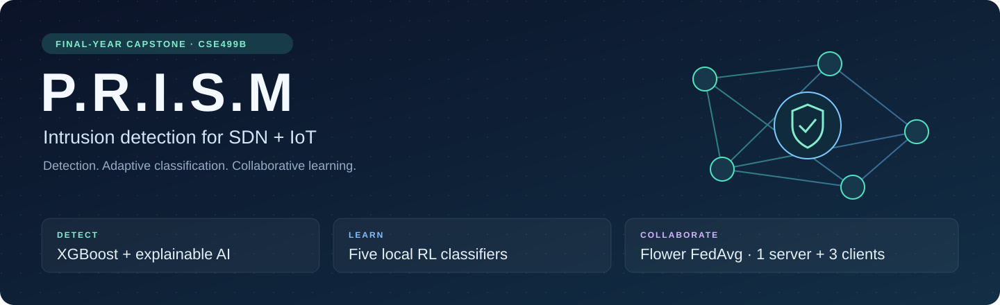
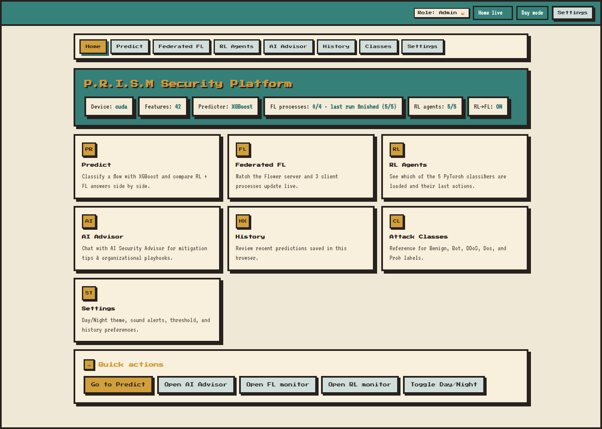
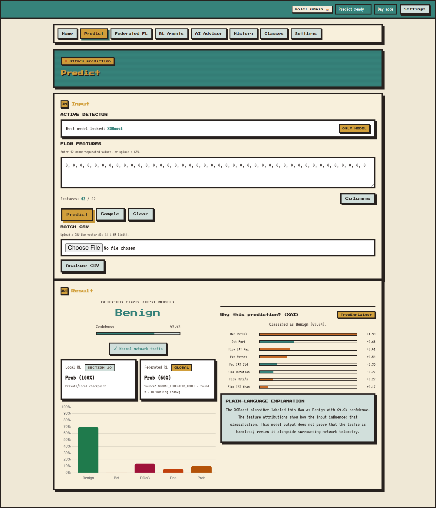
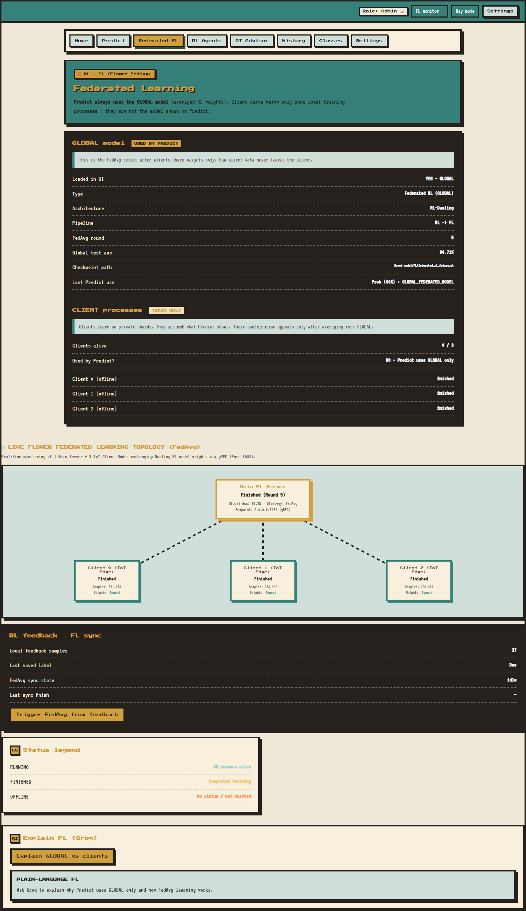
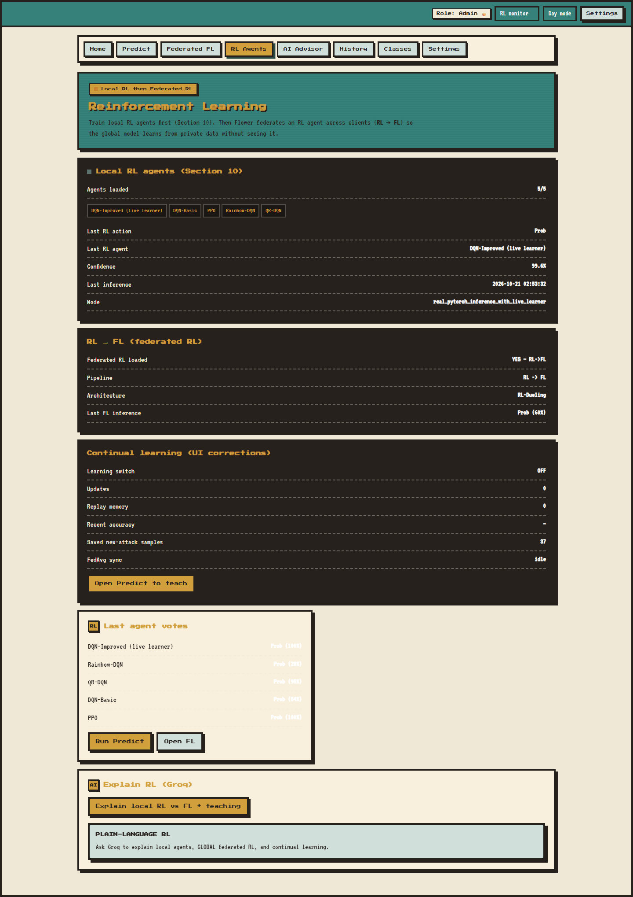
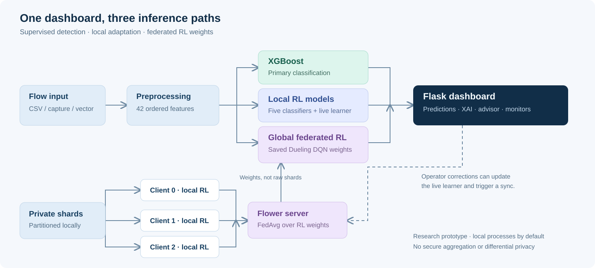

<p align="center">
  
</p>

# P.R.I.S.M

### Intrusion Detection for SDN and IoT with Federated and Reinforcement Learning

**Final-year project · Capstone project · CSE499B**

P.R.I.S.M is my final-year capstone project exploring how supervised learning,
reinforcement learning, federated training, and explainable AI can work together
in an intrusion detection platform for Software-Defined Networking (SDN) and IoT.
It brings an experimental training pipeline into a Flask dashboard for
network-flow classification, model comparison, learning feedback, and
cybersecurity explanations.

The dashboard uses **XGBoost as its primary detector**, with local PyTorch RL
classifiers and a global federated model alongside it. The current pipeline
uses **42 selected flow features** and five labels: **Benign, Bot, DDoS, Dos,
and Prob** (probing).

Maintained by [Shahriar811](https://github.com/Shahriar811).

> This repository contains the application and training source. Datasets,
> trained models, preprocessing binaries, credentials, feedback records,
> report drafts, and runtime logs are excluded. Train or separately restore
> matching artifacts before starting a fresh clone.

## Dashboard preview



These screenshots come from the actual local application. The prediction
example uses an artificial all-zero vector to demonstrate the interface;
it is not a benchmark or real captured traffic. Monitor screenshots show the
saved checkpoint state at capture time, with federation idle. Local filesystem
prefixes are removed from screenshot responses.

<details>
<summary><strong>View prediction, federated learning, and RL screenshots</strong></summary>

#### Flow classification and explanations



#### Federated learning monitor



#### Reinforcement learning agents



</details>

## What the project implements

| Component | Implementation |
| --- | --- |
| Primary detector | XGBoost classification of one flow or a CSV batch |
| Training experiments | Traditional ML, PyTorch deep-learning architectures, and comparative evaluation in the notebook |
| Local RL classifiers | DQN-Basic, DQN-Improved/Dueling DQN, PPO, Rainbow-DQN, and QR-DQN |
| Federated RL | Flower FedAvg over Dueling DQN weights, with one server and three client processes |
| Continual learning | Optional feedback-based updates to the live DQN learner, checkpoint saving, and federation triggers |
| Explainability | SHAP when supported, with a feature-importance fallback |
| Security advisor | Optional Groq-backed explanations and response guidance, with local fallback text |
| Live monitoring | Scapy-based packet capture, bidirectional flow statistics, and prediction requests |
| Dashboard | Prediction, FL/RL monitors, advisor, browser-local history, class reference, and settings |

The RL training is formulated as **cost-sensitive flow classification / a
contextual bandit** (`gamma = 0` in the notebook), rather than a sequential
network-control policy. Its actions are class labels. Response steps are
advisory; the project does not automatically install firewall or SDN rules.

## Architecture and learning flow



1. The notebook cleans data, encodes labels, splits train/test data, selects
   features, and fits preprocessing. SMOTE is applied to training data.
2. Supervised models and five local RL classifiers are trained and evaluated.
3. A Flower server and three independent clients implement RL-to-FL training.
   Clients train on local shards; the server averages model parameters with
   FedAvg and saves a global Dueling DQN checkpoint.
4. Flask loads XGBoost, the local RL agents, and the saved global model. The
   dashboard presents their classifications together with explanations.
5. When enabled, operator corrections update the live learner and save local
   feedback. A subsequent federation cycle can update the global checkpoint.

Clients run as separate local processes by default. Raw shards are read locally
by each client during federation; this implementation does not add secure
aggregation or differential privacy. Model parameters can themselves reveal
information, so the design is not a formal privacy guarantee. The topology
animation illustrates the workflow; it is not proof that each displayed packet
or weight update was transmitted.

## Repository layout

```text
P.R.I.S.M/
├── IDS_FL_RL_Combined.ipynb       # Training, evaluation, partitioning, exports
├── ids_server.py                 # Flask application and prediction APIs
├── ids_models.py                 # XGBoost / RL / FL model registry
├── live_sniffer.py               # Packet capture and flow feature extraction
├── rl_agent.py                   # Dueling network and local training utilities
├── rl_learner.py                 # Live continual-learning agent
├── rl_learn_routes.py            # Learning and feedback endpoints
├── feedback_store.py             # Local feedback persistence
├── rlfl_orchestrator.py          # Launches RL-to-FL training cycles
├── groq_explain.py               # Optional advisor and local fallbacks
├── federated/
│   ├── rl_server.py              # Flower RL aggregation server
│   ├── rl_client.py              # Private-shard RL client
│   ├── rl_fl_model.py            # Shared federated RL utilities
│   ├── run_rl_federated.bat      # One server and three clients on Windows
│   ├── server.py / client.py     # Legacy ResNet-MLP federation experiment
│   └── README.md
├── templates/                    # Jinja dashboard pages
├── static/                       # CSS and browser JavaScript
├── scripts/                      # Utilities, offline federation, upload checks
├── docs/images/                  # README illustrations and screenshots
├── requirements.txt
├── .env.example                  # Empty credential template
└── GITHUB_UPLOAD.md              # Upload policy and artifact notes
```

`Saved model/`, `federated/data/`, and `federated/feedback/` are generated or
supplied separately and ignored by Git. **`REport/` is deliberately excluded.**

## Setup

### 1. Clone and install

You need Python, pip, and an environment compatible with PyTorch and the packages
in `requirements.txt`. A CUDA-capable GPU is optional. Training and serving should
use compatible package versions; dependencies are not pinned to a lockfile.

```bash
git clone https://github.com/Shahriar811/P.R.I.S.M.git
cd P.R.I.S.M
python -m venv .venv
```

Activate the environment for your shell:

```powershell
# Windows PowerShell
.\.venv\Scripts\Activate.ps1
```

```bash
# Git Bash on Windows
source .venv/Scripts/activate

# Linux / macOS
source .venv/bin/activate
```

```bash
python -m pip install -r requirements.txt
python -m pip install jupyterlab ipykernel
```

### 2. Configure the optional advisor

```bash
# Git Bash, Linux, or macOS
cp .env.example .env
```

PowerShell users can use `Copy-Item .env.example .env`. Add your own
`GROQ_API_KEY` to `.env` only if using the hosted advisor. The example template
leaves that field empty. With no key configured, the code provides local fallback
explanations. Do not put credentials in source files, screenshots, or commits.

### 3. Prepare the dataset and train

Obtain **`ASEADOS_SDN_IoT.csv`** from a source you are authorized to use. Put it
in the repository root or its parent, or update `DATA_PATH` in the notebook.
No dataset download is included in this repository.

```bash
python -m jupyterlab
```

Open `IDS_FL_RL_Combined.ipynb` and use this order:

| Notebook stage | Purpose |
| --- | --- |
| Sections 1–8 | Setup, preprocessing, supervised/deep-learning experiments, evaluation |
| Section 9.1 | Generate client shards, test data, and metadata in `federated/data/` |
| Section 10 | Train and save the five local RL classifiers |
| Section 11 | Export the shared scaler, label encoder, feature order, and manifest |
| Section 10B + the launcher below | Federate the trained RL model using Flower |

Section 9 also includes an older ResNet-MLP federation experiment. Its
`run_federated.bat` launcher and Section 9.4 scoring belong to that older model.
Use **`run_rl_federated.bat`** for RL-to-FL, and do not evaluate an RL checkpoint
with the legacy ResNet scoring cell.

The full notebook trains memory-intensive ensemble models. Allow sufficient RAM,
disk space, and training time. Keep the feature order and use preprocessing
artifacts from the same training run as the models.

### 4. Run federated RL

After the RL checkpoints and shards exist, launch from the project root in
Windows PowerShell or Command Prompt:

```powershell
.\federated\run_rl_federated.bat
```

This opens one Flower server and three client processes. See the
[federated learning guide](federated/README.md) for manual startup.
The global checkpoint is written to `Saved model/FL/federated_rl_fedavg.pt`
and `federated/global_model.pt`.

An additional **in-process** FedAvg utility is available:

```bash
python scripts/train_rl_federated_offline.py --rounds 3
```

That utility does not demonstrate separate Flower client/server processes.

### 5. Start the dashboard

At minimum, restore or generate these matching files:

```text
Saved model/scaler.joblib
Saved model/label_encoder.joblib
Saved model/feature_cols.joblib
Saved model/TM/xgboost.joblib
```

For the complete comparison dashboard, also generate `Saved model/RL/*.pt`,
`Saved model/FL/federated_rl_fedavg.pt`, and `federated/data/` locally.

```bash
python ids_server.py
```

Open **http://127.0.0.1:7860**. The default server binds to localhost with
debugging disabled. The app can reload a new federated checkpoint while running;
restart after replacing preprocessing artifacts or local RL checkpoints.

## Using the application

| Page | URL | Use |
| --- | --- | --- |
| Home | `/` | Model readiness and navigation |
| Predict | `/predict-ui` | Flow/CSV prediction, probabilities, XAI, and feedback |
| Federated FL | `/fl` | Saved global checkpoint and client/server status |
| RL Agents | `/rl` | Local agent readiness and continual learner activity |
| AI Advisor | `/advisor` | Cybersecurity explanations and response guidance |
| History | `/history` | Recent predictions stored in the current browser |
| Classes | `/about` | Reference for the five class labels |
| Settings | `/settings` | Theme and interface preferences |

Single-flow input expects 42 numeric values in the order reported by `/info`.
CSV input should use the expected feature columns. The web application limits
request bodies to 1 MiB, including upload overhead.

This artificial vector checks the API but has no benchmark meaning:

```python
import requests

response = requests.post(
    "http://127.0.0.1:7860/predict",
    json={"features": [0.0] * 42},
    timeout=30,
)
response.raise_for_status()
result = response.json()
print(result["prediction"], result["confidence"])
```

For packet capture, install your platform's capture driver and monitor only
authorized interfaces. Windows Scapy capture commonly needs Npcap and suitable
privileges. Start with:

```bash
python live_sniffer.py --help
python live_sniffer.py --interface "Wi-Fi"
```

The sniffer approximates bidirectional flow statistics. Validate their definitions
and distributions against the training pipeline before treating live predictions
as reliable security evidence.

## Security and publication policy

- **Excluded:** `.env` and tokens, `REport/`, `scratch/`, trained models,
  training/test shards, feedback, captures, caches, and runtime logs.
- **Credentials:** configure locally using `.env.example`. Revoke credentials
  if they are ever exposed.
- **Public access:** the role picker changes the browser view; it is not
  server-side authentication. Learning and training routes need access controls
  before public deployment. Do not expose the app through ngrok as a production
  service without authentication and further hardening.
- **Model loading:** use only trusted joblib/pickle and PyTorch artifacts.
  Deserializing untrusted checkpoints can execute code.
- **Research scope:** confidence scores, novelty flags, explanations, and
  federation do not establish production accuracy, formal privacy, or protection
  against every attack.

Before committing, clear notebook outputs and check the staged snapshot:

```bash
python scripts/github_safety.py prepare
git add .
python scripts/github_safety.py check
```

The checker rejects blocked paths, detected credentials, notebook outputs, and
files at least 50 MiB. It scans the current Git index, not past commits. See
[GITHUB_UPLOAD.md](GITHUB_UPLOAD.md) for the complete upload policy.

## Technology and academic context

Built with Python, Flask/Jinja, NumPy, Pandas, Scikit-learn, XGBoost, PyTorch,
Flower, SHAP, Scapy, Chart.js, and optional Groq integration. The notebook also
includes LightGBM, CatBoost, and additional ML/deep-learning experiments.

Developed as a **final-year capstone project** to study intrusion detection,
distributed training, adaptive classification, and explainable decision support
in SDN-IoT environments. Academic reports and review material are intentionally
kept outside this source repository. No separate open-source license has been
added to this repository.
